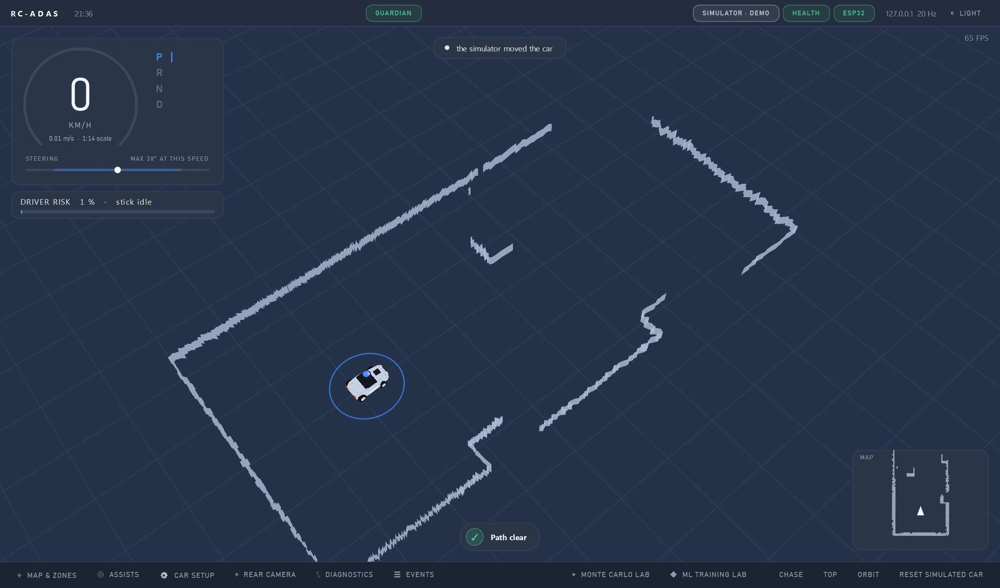
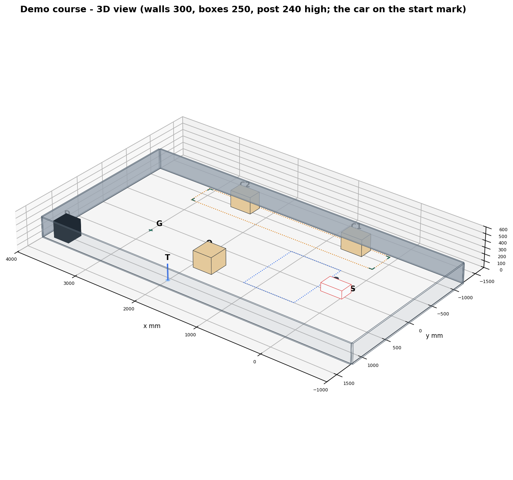
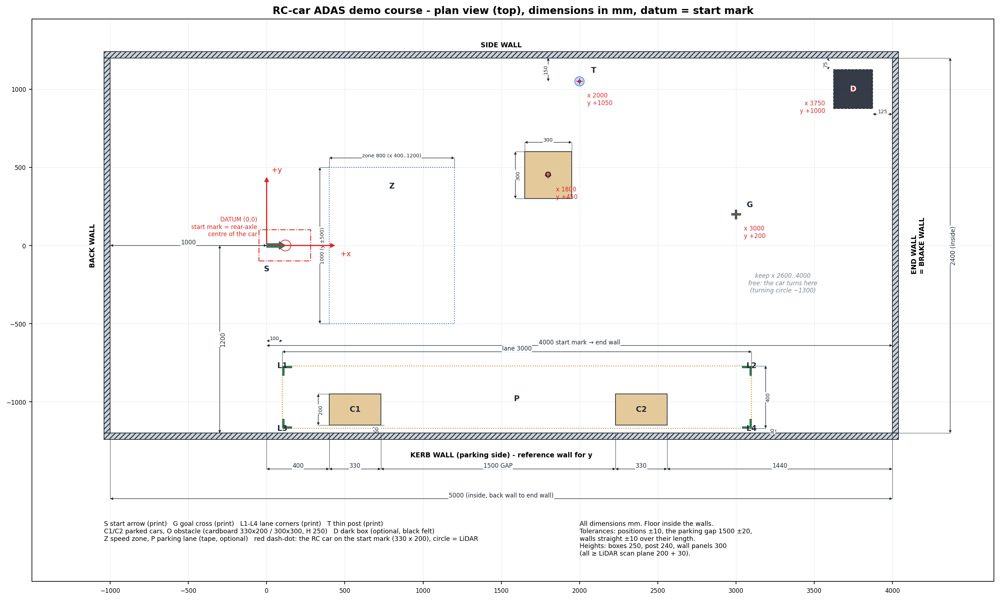
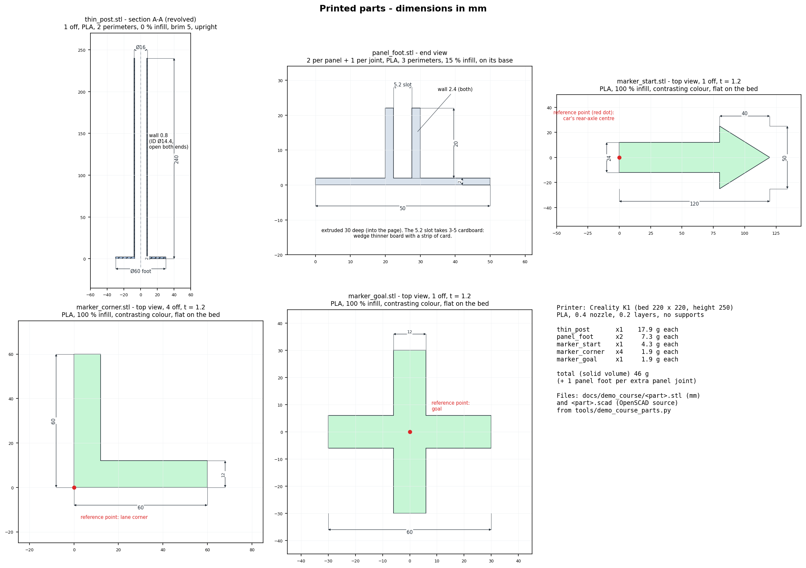
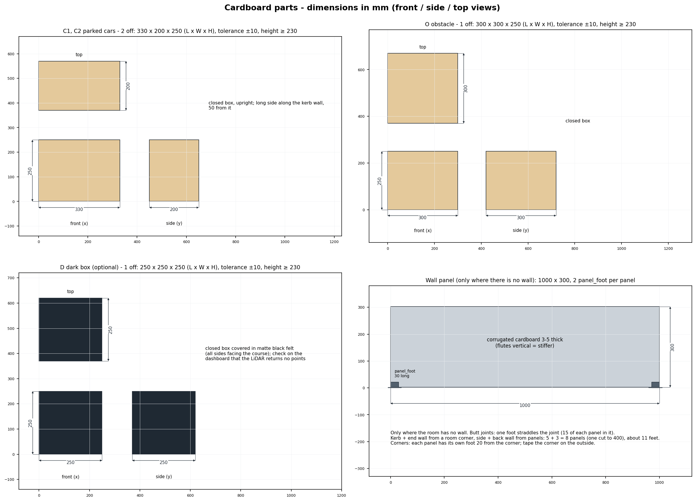

# Demo course - build guide (TODO AL, AL7)

A small course that shows everything the car can do, station by station, with as few printed parts as possible. One geometry
(`sim/demo_course.py`) drives the twin world `demo` (dashboard: Parking Simulator -> DEMO), the print files, every drawing and CAD file in
`docs/demo_course/`, and the scripted check (`python tools/hmi_test.py demo_course`). Change the layout only there and run
`python tools/demo_course_parts.py` and `python tools/demo_course_drawings.py` again.

*The course in the digital twin as the dashboard shows it, the car on the start mark (the grey bands are what the LiDAR sees: walls, the
obstacle and the two parked cars; the dark box is invisible to it by design).*

## 1. Coordinate system and datum
- **Units mm.** Floor = the inside faces of the walls, 5000 x 2400.
- **Datum (0, 0) = the start mark** = where the car's **rear-axle centre** stands at the start. +x along the kerb wall towards the end
  (brake) wall, +y away from the kerb wall, +z up from the floor. All object positions below are the centre of the object's footprint
  (markers: their reference point, see 4).
- Two **reference walls** for measuring on site: the **kerb wall** (y = -1200) and the **end wall** (x = 4000). The start mark is
  4000 from the end wall and 1200 from the kerb wall; the back wall is 1000 behind it.

## 2. Plan (dimensioned)

## 3. Placement table
Also as `docs/demo_course/placement.csv` (one row per object, with notes). "End wall" / "kerb wall" = distance from that wall to the
object's nearest face (what a tape measure reads); markers: to their reference point.

| ID | Object | x | y | L x W x H | rot | from end wall | from kerb wall |
|---|---|---|---|---|---|---|---|
| W1 | kerb wall (parking side) | x -1000..4000 | -1200 | 5000 x - x 300 | - | - | - |
| W2 | end wall = brake wall | 4000 | y -1200..1200 | - x 2400 x 300 | - | - | - |
| W3 | side wall (recommended) | x -1000..4000 | 1200 | 5000 x - x 300 | - | - | 2400 |
| W4 | back wall (recommended) | -1000 | y -1200..1200 | - x 2400 x 300 | - | 5000 | - |
| C1 | parked car 1, cardboard box | 565 | -1050 | 330 x 200 x 250 | 0 | 3270 | 50 |
| C2 | parked car 2, cardboard box | 2395 | -1050 | 330 x 200 x 250 | 0 | 1440 | 50 |
| O | obstacle, cardboard box | 1800 | 450 | 300 x 300 x 250 | 0 | 2050 | 1500 |
| T | thin post (printed) | 2000 | 1050 | Ø16 x 240 (Ø60 foot) | - | 1992 | 2242 (150 from the side wall) |
| S | start arrow (printed) | 0 | 0 | 120 x 50 x 1.2 | 0 | 4000 | 1200 |
| G | goal cross (printed) | 3000 | 200 | 60 x 60 x 1.2 | 0 | 1000 | 1400 |
| L1 | lane corner, road side, start end | 100 | -770 | 60 x 60 x 1.2 | -90 | 3900 | 430 |
| L2 | lane corner, road side, far end | 3100 | -770 | 60 x 60 x 1.2 | 180 | 900 | 430 |
| L3 | lane corner, kerb side, start end | 100 | -1170 | 60 x 60 x 1.2 | 0 | 3900 | 30 |
| L4 | lane corner, kerb side, far end | 3100 | -1170 | 60 x 60 x 1.2 | 90 | 900 | 30 |
| D | dark box (optional) | 3750 | 1000 | 250 x 250 x 250 | 0 | 125 | 2075 (75 from the side wall) |
| Z | speed zone (optional tape) | 800 | 0 | 800 x 1000 | 0 | 2800 | 700 |
| P | parking lane (optional tape) | 1600 | -970 | 3000 x 400 | 0 | 900 | 30 |

Key relations to hold (they are what the car needs): the **parking gap between C1 and C2 = 1500 ±20** (the car needs at least 1100);
both cars **50 from the kerb wall**; **the floor from x 2600 to the end wall stays empty** (the car turns there after leaving the space -
its turning circle is ~1300); nothing else on the floor. Other positions ±10.

**Heights.** The LiDAR sees only what crosses its horizontal scan plane, **200 above the floor** on this car (measure it: floor to the
middle of the LiDAR's window, and change `LIDAR_PLANE_M` if it differs). Everything it must see is **at least scan plane + 30 = 230**
tall: boxes 250, the post 240, wall panels 300. A 150-high box is invisible to it.

## 4. Printed parts (Creality K1: bed 220 x 220, height 250)

| File | Qty | What | Print | PLA |
|---|---|---|---|---|
| `thin_post.stl` | 1 | Ø16 tube, wall 0.8, 240 high, on a Ø60 x 2 foot; open both ends | upright, 2 perimeters, 0 % infill, 5 mm brim | ~18 g |
| `panel_foot.stl` | 2 per wall panel + 1 per butt joint | U-channel: base 50 x 2, two walls 2.4 x 20 high, slot 5.2, 30 long | on its base, 3 perimeters, 15 % infill | ~7 g each |
| `marker_start.stl` | 1 | arrow 120 long: shaft 24 x 80, head 50 wide x 40 | flat, 100 % infill | ~4 g |
| `marker_corner.stl` | 4 | L, legs 60 x 12 | flat, 100 % infill | ~2 g each |
| `marker_goal.stl` | 1 | cross 60 x 60, bars 12 | flat, 100 % infill | ~2 g |

All markers are 1.2 thick, in a colour that contrasts with the floor; fix them with double-sided tape. PLA, 0.4 nozzle, 0.2 layers,
no supports. About 46 g of filament with 2 feet (solid-volume estimate; +7 g per extra foot). The `.scad` files next to the STLs are the
parametric sources (OpenSCAD); `tools/demo_course_parts.py` writes both.

**Reference points** (red dots in the drawing): the start arrow's **tail-edge midpoint** = the car's rear-axle centre (the car's rear
bumper is then 50 behind it, the arrow points along +x); a corner marker's **outer corner** = the lane corner, legs along the lane edges
pointing into the lane (rotations in the table: 0 = legs along +x and +y); the goal cross's **centre**.

## 5. Cardboard parts

| Part | Qty | Size (L x W x H) | Notes |
|---|---|---|---|
| Parked car (C1, C2) | 2 | 330 x 200 x 250 | any closed box; long side along the kerb wall |
| Obstacle (O) | 1 | 300 x 300 x 250 | any closed box |
| Dark box (D, optional) | 1 | 250 x 250 x 250 | covered in matte black felt on every side facing the course |
| Wall panel | as needed | 1000 x 300, 3-5 thick | only where the room has no wall; flutes vertical; one cut to 400 for a 2400 wall |

Sizes ±10 (a box a little bigger is fine - the car measures it). Weigh the boxes down (a book inside) so a light touch does not move
them. **Walls:** best is a room corner - its two walls are the kerb wall and the end wall; then only the side wall (5 panels) and the
back wall (2 panels + one 400) are cardboard: 8 panels, about 11 feet. Butt joints: one foot straddles each joint (15 of each panel in
its slot); at a corner each panel has its own foot 20 from the corner and the corner is taped outside. Walls straight within ±10 over
their length; no glass, mirrors or very glossy surfaces at the scan height (the LiDAR sees through or past them).

## 6. CAD files (`docs/demo_course/`)
| File | Content |
|---|---|
| `course_layout.dxf` | the plan, mm, datum at the start mark (ASCII DXF R12: LINE / CIRCLE / TEXT). Layers: `WALLS_INSIDE`, `CARDBOARD`, `PRINTED` (marker outlines, post), `TAPE` (zone, lane), `CAR_AT_START` (car outline + LiDAR), `DATUM`, `TEXT` (object IDs) |
| `course_assembly.scad` | the whole course in 3D (OpenSCAD): walls, boxes, the post, the markers at their positions and rotations, the car (reference, `%`); export STL / 3MF / a 2D projection |
| `placement.csv` | the placement table with notes - for a spreadsheet or a CAD script |
| `*.stl`, `*.scad` | the printed parts (mm, Z up, as printed) |
| `layout_plan.png`, `layout_3d.png`, `parts_printed.png`, `parts_cardboard.png`, `dashboard_view.png` | the drawings above |

## 7. Building it on site
1. Choose the floor: 5000 x 2400 free, flat, along a straight wall (kerb wall), ideally in a corner (end wall). Clear it completely.
2. Missing walls: stand the cardboard panels in their feet on the lines y = +1200 (side) and x = -1000 (back), measured from the real walls.
3. **Start arrow:** 4000 from the end wall, 1200 from the kerb wall, pointing at the end wall, parallel to the kerb wall (check: the
   arrow's tail and tip both 1200 from the kerb wall).
4. **Parked cars:** C1 with its long side 50 from the kerb wall, its far face 3270 from the end wall; C2 the same, 1440 from the end wall.
   Check the gap between them: 1500.
5. **Lane corners:** L3/L4 30 from the kerb wall, L1/L2 430 from it; L1/L3 3900 and L2/L4 900 from the end wall.
6. **Obstacle** O, **post** T, **goal cross** G by the table. Optional: tape the speed zone and the lane outline for the audience.
7. **Dark box** D only for its own station (it is removed for the others).
8. **Checks on the dashboard** (car on the start arrow, relay running, ORIGIN pressed): the walls, both cars, the obstacle and the post
   show as LiDAR points at their places on the map (the post as a small cluster); the dark box shows **no** points (if it does, more felt).

## 8. The RC car (for reference)
330 long x 200 wide; from its rear axle: rear bumper -50, front bumper +280; LiDAR centre 120 ahead of the rear axle, scan plane
~200 above the floor; turning circle ~1300; it stops 18-30 cm before the end wall at full throttle (twin).

## 9. Demo script
Set-up on the dashboard: car on the arrow, ORIGIN, a slow look round (or one AUTO EXPLORE lap) so the map shows the room; draw the speed
zone (Zones tool, 10 km/h) over Z and the parking lane (Parking lane tool) over the four corner marks.
1. **Parking:** Park tool, click in the gap, hold RT. The car crosses the speed zone at the zone's limit, drives past the gap and
   reverses in. Let go of RT any time: the car stops (the driver keeps control).
2. **Click-to-go:** click the goal cross. The car pulls out of the space, turns left and stops on the cross; point out the post on the map.
3. **Return to start:** the home tile. The car turns round at the far end and drives past the obstacle back to the arrow.
4. **Emergency brake:** steer straight at the end wall, full throttle; the gate brakes.
5. **(Optional) LiDAR-blind object:** put D in, crawl into it. The bumper marks it on the map; it is then avoided.

## 10. Twin check
`python tools/hmi_test.py demo_course` runs the whole script on the real dashboard against the twin (actuation noise on) and prints per
station: park inside the lane, kerb gap, heading; goal error and contacts; peak speed in the zone vs. its cap; thin post on the map; home
error; brake gap. `python tools/hmi_test.py demo_overview` makes the dashboard picture at the top.

Latest twin result (26 Oct 2026, 4 runs, actuation noise on): parking 4/4 (3.1-4.9 cm from the kerb, 0 contacts), speed zone held
(peak 0.205-0.214 m/s against 0.198), thin post on the map 4/4, emergency brake 18-22 cm from the wall, click-to-go 3/4 (3.6-5.4 cm),
return to start 2/3; the whole course in one go 2/4. The failures are the planner giving up after three stalled re-plans close to a
wall or a parked car (TODO AK12), not the course. On the car: rehearse each station once; if the car says "stuck", take over with the
stick, back it off a little and click again.
